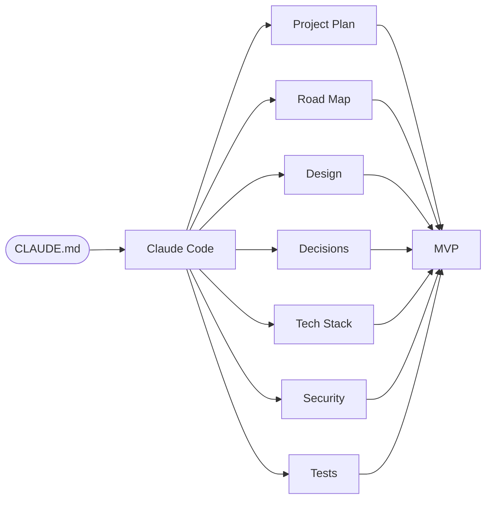

# dr-claude-md
Baseline CLAUDE.md and accompanying Markdown files; so simple, even I could use it.

19 NOV 2026

## CLAUDE.md as Project Start

CLAUDE.md is a useful starting point when leveraging an AI agent for building a cloud-hosted application for the world wide web.

With so many websites and web apps being spun up these days, it is a common occurrence that some essential aspect such as security or a publically viewable project roadmap is missed. The AI agent is diligent to do all that we instruct it to and more, but still things get missed.

To avoid this problem, we present a CLAUDE.md file which is a collection of the common starting point regarded by this team as best practice.

This document has been compiled after running several agentic coding projects, and is all but certain to be further amended in the coming season.

